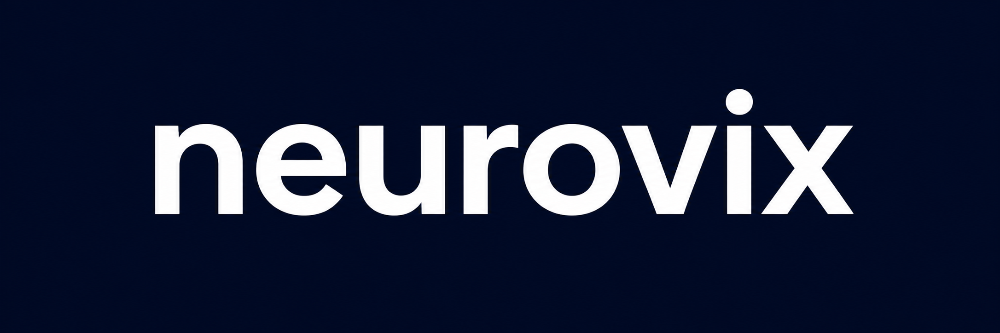

<p align="center">
  
</p>

<p align="center">
  Custom software, automation and artificial intelligence for businesses.
</p>

<p align="center">
  
  
  
  
</p>

---

## About

The official website of **Neurovix**, a software company based in Saltillo, Coahuila, Mexico. It presents our services, projects and contact channels.

**Services:** web and mobile development, ERP/CRM systems, IoT/IIoT automation and applied AI.

## Local development

Requires Node.js 24 and pnpm.

```bash
git clone git@github.com:neurovix/neurovix.app.git
cd neurovix.app
pnpm install
pnpm dev
```

The site runs at `http://localhost:3000`.

| Command          | Description                         |
| ---------------- | ----------------------------------- |
| `pnpm dev`       | Start the development server        |
| `pnpm build`     | Create a production build           |
| `pnpm start`     | Serve the production build          |
| `pnpm lint`      | Run ESLint                          |
| `pnpm typecheck` | Type-check with TypeScript          |

## Structure

```
src/
├── app/          Routes (App Router)
├── components/   UI components
└── lib/          Site configuration and content
public/           Static files and icons
```

Editable content (contact details, services, clients) lives in `src/lib/site.ts`.

## Branch flow

```
develop  →  testing  →  main
```

- Every push to `develop` is merged into `testing` automatically.
- On `testing`, CI runs lint, type checks, tests and a production build.
- If everything passes, a pull request from `testing` to `main` is opened.

## Contact

<p>
  <a href="https://www.facebook.com/neurovix.nv"></a>
  &nbsp;
  <a href="https://www.instagram.com/neurovix.nv/"></a>
  &nbsp;
  <a href="https://www.linkedin.com/company/neurovix/"></a>
</p>

fernandovazquez.favm@gmail.com · +52 (844) 858-0335

<br />

<p align="center">
  
  <br />
  <sub>© Neurovix. All rights reserved.</sub>
</p>
